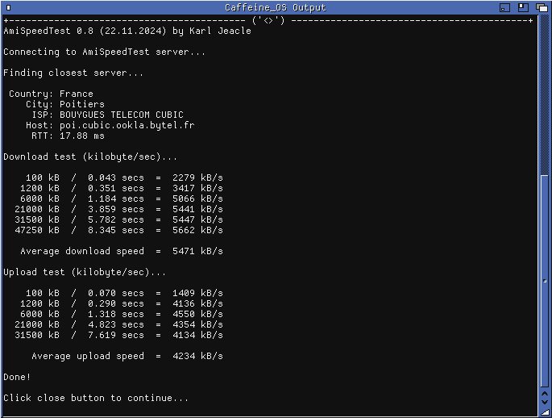

# smsc95xx.class

**SANA-II Ethernet driver for the SMSC/Microchip LAN95xx USB Ethernet controllers, as a
Poseidon USB class, for AmigaOS 3 on PiStorm + Emu68.**

The Raspberry Pi 3B has no Ethernet MAC in its SoC: its network port is a LAN9514, a USB
hub with an Ethernet controller behind it, wired to the DWC2 USB core. Until now there was
no network driver for it on AmigaOS. `smsc95xx.class` is a class for the Poseidon USB stack
that binds to the LAN95xx and provides `smsc95xx.device`, a SANA-II network device that
Roadshow (and any other SANA-II stack) can use.

> **Status: work in progress (version 0.17).** It works and is stable in the tests done so
> far (DHCP, ping, large downloads and uploads, a USB stick on the same hub), but it is young:
> it has been tested on one machine only, see [Status and limits](#status-and-limits).

## Tested environment

| | |
|---|---|
| Computer | Amiga 1200 with a **PiStorm32** |
| CPU emulation | **Emu68 1.0.7** (08.12.2025) |
| Board | **Raspberry Pi 3B, revision 1.2** |
| System | CaffeineOS (AmigaOS 3.x, Kickstart 45.20) |
| USB stack | **Poseidon 4.5** (14.10.2014), Trident 4.5 |
| USB host controller | `dwc2usb.device` 0.11 by Lemaru (see [Requirements](#requirements)) |
| TCP/IP stack | Roadshow |

Other Raspberry Pi models, other Poseidon versions and other TCP/IP stacks have **not** been
tested.

## What works

- Binding to the LAN9512/LAN9514 (`0424:EC00`) and the LAN9500 (`0424:9500`); chip reset and
  initialisation, internal PHY, auto-negotiation, link state (10/100 Mbit/s, half/full duplex).
- MAC address taken from the device tree (`local-mac-address` of `/aliases/ethernet0`, set by
  the Raspberry Pi firmware), with the VideoCore mailbox as fallback. The Pi 3 has no EEPROM.
- A SANA-II device, `smsc95xx.device`, created by the class when it is loaded:
  `CMD_READ`, `CMD_WRITE`, broadcast and multicast writes, device query (old and new style),
  station address, multicast addresses and ranges (hardware hash filter), promiscuous mode,
  packet type tracking and statistics, events, orphan reads, online/offline, flush, abort.
- Receive of several frames per USB transfer (the chip's multi-frame mode).
- Transmit of several frames per USB transfer: the writes waiting when the transmitter is free
  leave together (up to 16 frames, 4.5 per transfer on average during an upload).
- A unit that survives a restart of Poseidon, so a running TCP/IP stack is not left with a
  dangling device; requests fail at once while the USB device is gone.

## Performance

Measured on the setup above (one machine, indicative, not a benchmark), with the Roadshow
interface file of [`examples/smsc95xx`](examples/smsc95xx):

| | 0.10 | 0.17 |
|---|---|---|
| Download (AmiSpeedTest) | 3.5 MB/s | **5.2 to 5.5 MB/s** (about 43 Mbit/s) |
| Upload (AmiSpeedTest) | 1.3 MB/s | **3.6 to 4.2 MB/s** (about 31 Mbit/s) |
| 1 MiB file from the PC to the Amiga (rxnet) | 0.7 to 2.1 MB/s | 1.7 to 2.8 MB/s |
| 1 MiB file from the Amiga to the PC (rxnet) | 1.3 MB/s | 2.1 to 2.9 MB/s |
| Driver task during an upload | 21 % CPU, 2900 task switches/s | 10 % CPU, 750 task switches/s |
| Ping on the local network | about 4 ms | about 6 ms, no loss |
| Large transfers, compared byte for byte | identical | identical |

A 100 Mbit/s link carries about 12 MB/s: the limits are the emulated 68k, the TCP/IP stack
and the USB path, not the chip. During a transfer the whole machine is busy (about 70 %), and
the USB host controller driver takes more of it than this driver.

What made the difference, from 0.10 to 0.17:

- **Roadshow's buffers.** With its defaults (32 read and 32 write requests) the write queue was
  always full and receive was irregular: see the interface file.
- **Several frames per transmit transfer.** The chip accepts them (LAN950x data sheet
  DS00001875D, 5.3.1.2); only one transfer is in flight, the next one takes every write queued
  meanwhile.
- **The task priority.** The driver's task runs at the priority of the TCP/IP stack (0). At
  Poseidon's usual 5 it pre-empted Roadshow on every write and sent the frames one by one, so
  the batches above never formed: upload stayed at 1.3 MB/s.
- **The link poll.** Reading the PHY costs several USB control transfers during which the task
  serves no traffic; it is now skipped while frames arrive, and done once a second otherwise.



## Requirements

- AmigaOS 3.x on Emu68 (PiStorm / PiStorm32) with a Raspberry Pi 3 family board.
- **Poseidon 4.x.** The library vectors it calls were checked against 4.5 only, see
  [`docs/ABI-poseidon-4.5.md`](docs/ABI-poseidon-4.5.md).
- A DWC2 host controller driver for Poseidon on the Pi 3: **`dwc2usb.device` by Lemaru**,
  released at <https://github.com/LemaruX/dwc2usb.device> (binary releases; the sources are
  not published). This project does not contain or depend on its source code; it only uses it
  through Poseidon.
- A TCP/IP stack using SANA-II (tested with Roadshow).

## Installation

1. Copy `smsc95xx.class` to the drawer where Poseidon keeps its classes
   (`SYS:Classes/USB/` with Poseidon 4.x).
2. Start Trident, add the class (*Classes*, then *Class Scan* or the add button), and restart
   Poseidon (or reboot). Bound to the Ethernet controller, the *Vendor* device then shows
   `smsc95xx.class` in the *Bindings* column.
3. The Poseidon message log shows the progress:
   ```
   smsc95xx.class  Board MAC (device tree) b8:27:eb:xx:xx:xx.
   smsc95xx.class  Receive mode: multi-frame, bulk-in empty response on.
   smsc95xx.class  Chip initialised, waiting for link.
   smsc95xx.class  Link up: 100 Mbit/s, full duplex.
   smsc95xx.class  Receiver and transmitter running; smsc95xx.device unit 0.
   ```
4. Create the Roadshow interface file `DEVS:NetInterfaces/smsc95xx` (see
   [`examples/smsc95xx`](examples/smsc95xx)):
   ```
   DEVICE=smsc95xx.device
   UNIT=0
   CONFIGURE=DHCP
   IPREQUESTS=128
   WRITEREQUESTS=128
   ARPREQUESTS=8
   REQUIRESINITDELAY=NO
   COPYMODE=FAST
   ```
   The last five lines matter for speed: Roadshow's default of 32 requests each way is too
   few for this device.
5. Run `AddNetInterface smsc95xx`.

There is **no file** to put in `DEVS:Networks/`: like the other Poseidon network classes, the
device lives in memory and is created by the class. It only exists while the USB Ethernet
controller is bound, so the TCP/IP stack must be started **after** Poseidon has bound it. A
startup script can retry `AddNetInterface smsc95xx QUIET` until it succeeds (the command
returns `WARN` when the device is not there yet).

## Optional settings

Global variables read when the chip is initialised (`SetEnv SAVE name value`; remove the
variable to go back to the default):

| Variable | Effect |
|---|---|
| `smsc95xx.selftest` | An IPv4 address (`192.168.1.254`): one ARP probe (RFC 5227, sender 0.0.0.0) is sent for it a few seconds after the link is up, to exercise transmit and receive without a TCP/IP stack. Nothing is sent without this variable. |
| `smsc95xx.single` | Any value: one Ethernet frame per USB receive transfer instead of the multi-frame mode. A fallback if the multi-frame mode misbehaves. |
| `smsc95xx.nobir` | Any value: does not set the chip's "bulk-in empty response" bit. For experiments. |
| `smsc95xx.bulkindly` | A number of microseconds: how long the chip waits for more frames before it ends a receive transfer, instead of 136 (the chip's own default, 34, gave a slower download; 300 was no better than 136). For experiments. |
| `smsc95xx.taskpri` | A number from -5 to 19: the priority of the driver's task, instead of 0 (the priority of Roadshow). Above the stack, upload is about half as fast; below it, download suffers and a busy program at priority 0 holds the network up. For experiments. |

## Status and limits

- Tested on **one** machine: Amiga 1200 + PiStorm32 + Emu68 1.0.7 + Raspberry Pi 3B 1.2. Other
  boards of the BCM2837 family (Pi 3B+, Zero 2 W, CM3) are untested.
- Tested with Roadshow only. Other SANA-II stacks (Miami, Genesis, ...) are untested.
- One transmit transfer at a time, on purpose: `dwc2usb.device` does not keep the transfers
  of one endpoint in order, so two in flight could leave out of order.
- The driver's task shares the CPU with the programs at priority 0: while one of them
  computes, the network slows down (as Roadshow itself does), it does not stop.
- The chip's DMA copy hooks, the SANA-II packet filter hook, the extended statistics and
  `S2_CONNECT` are not implemented; `LastStart` in the global statistics is not set.
- Unplugging and plugging back the cable is detected (link down, link up). Hot-unplug of the
  USB device and restarting Poseidon under load are not tested thoroughly.
- Only one bulk-in transfer is kept pending on purpose: the DWC2 driver has two bulk
  channels, and a pending IN holds one until the driver takes it back after a 100 ms slice,
  so more would starve transmit and any other USB device behind the same hub.

Ideas for later: test the Pi Zero 2 W (with a LAN95xx adapter) and other stacks.

## Building

The build uses bebbo's `m68k-amigaos-gcc` (tested with 6.5). `devices/sana2.h` is part of the
SANA-II / Roadshow section of the official NDK and is not in every toolchain, so point
`SANA_INC` at it:

```sh
make PREFIX=/opt/amiga SANA_INC=/path/to/NDK/SANA+RoadshowTCP-IP/include
make fpucheck        # proves the binary has no FPU instruction
```

The result is `build/smsc95xx.class`. The build is `-m68040 -msoft-float -nostdlib`: Emu68's
FPU is partial, so the class must contain no FPU code. Architecture notes and the Poseidon
ABI findings are in [`docs/`](docs/).

## Provenance and license

Released under the **Mozilla Public License 2.0** (see [`LICENSE`](LICENSE)). The code is
written from hardware facts (register map, initialisation sequence, frame formats) taken from
the Microchip LAN951x datasheet and from the BSD-licensed OpenBSD/NetBSD `if_smsc` drivers,
and from the public Poseidon and SANA-II interfaces. No GPL source (including Linux
`smsc95xx.c`) is copied, and nothing from the sources of `dwc2usb.device` is used.

## Thanks

- **Lemaru**, a very big thank you: for his constant support during this work, and above all
  for `dwc2usb.device`, the DWC2 host controller driver for Poseidon on the Raspberry Pi 3
  family, without which none of this could exist. It is hosted at
  <https://github.com/LemaruX/dwc2usb.device> (binary releases, no sources). The USB path of
  this driver is his.
- **Claude Schwarz**, who designed the **PiStorm** (the hardware this runs on) and whose
  tremendous technical support made this work possible. A huge thank you.
- **Michal Schulz**, for [Emu68](https://github.com/michalsc/Emu68),
  [WiFiPi.device](https://github.com/michalsc/WiFiPi.device) and `devicetree.resource`.
- **Rondoval**, for the [Emu68 driver stack](https://github.com/rondoval/emu68-driver-stack)
  and its `genet.device`, a model for a SANA-II driver on Emu68.
- **Chris Hodges** for Poseidon, and the **AROS** team who maintain it; the authors of the
  OpenBSD and NetBSD `smsc` drivers, whose register documentation made the chip easy to
  understand; and the whole Emu68 / PiStorm community.
- **Claude** (Anthropic), the AI assistant that helped write the code and these notes
  under the author's direction and review.
